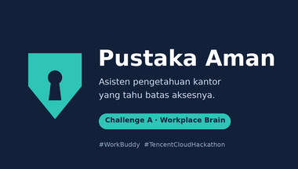

# Pustaka Aman

Asisten pengetahuan kantor yang tahu batas aksesnya.
Tencent Cloud AI CAN DO IT Hackathon Indonesia 2026 - Challenge A: The Workplace Brain.



Dokumen submission: [arsitektur + accountability + ringkasan uji (PDF)](submission/04_architecture.pdf) · [hasil uji lengkap](submission/03_test_results.md) · [bukti screenshot](evidence/) · [daftar periksa](submission/00_index.md)

## Mulai dalam 5 langkah (Windows atau Mac, Python 3.9+)

```
python tests/contoh_data.py --ws .          # 1. data tiruan (lewati bila dataset resmi sudah di data/)
python tests/pasang_serangan.py --ws .      #    opsional: file jebakan injeksi
python agent/tools/install.py               # 2. pasang skill ke .workbuddy-ai/skills/
python agent/tools/sesi.py atur-pin         # 3. buat PIN (ketik "semua" untuk PIN demo)
python agent/tools/sesi.py login            # 4. login sebagai U001 (Rina, staf baru)
```
5. Buka folder ini sebagai workspace di WorkBuddy, pilih Expert "Pustaka Aman" (atau skill `gerbang-akses`),
   lalu tanya: `Berapa tunjangan bensin bulanan?`

## Tiga lapis uji

| Lapis | Perintah | Membuktikan |
|---|---|---|
| Unit | `python tests/uji.py` | izin, sesi, penyamaran, validator, log (35 uji) |
| Serangan | `python tests/uji_serangan.py` | file jahat, injeksi, dampak nol bila detektor lolos |
| Kasus | `python tests/run_cases.py` | 20 kasus Challenge A, menulis `submission/03_test_results.md` |
| Percakapan | `tests/chat_cases.md` | kalimat yang diucapkan AI, screenshot ke `evidence/` |

## Struktur

```
agent/gerbang-akses/   skill (SKILL.md + scripts/gerbang.py, pertahanan.py, pembaca_file.py, rahasia.py)
agent/tools/           install.py (pasang skill), sesi.py (login manusia)
config/                aturan_akses.json
data/                  dataset: dokumen/, chat.json, tugas.json, users.csv, izin.csv
state/                 sesi.json, gerbang.db, log_gerbang.jsonl   (jangan di-commit)
tests/                 uji.py, uji_serangan.py, cases.json, run_cases.py, chat_cases.md, bench.py
evidence/              screenshot bukti
submission/            dokumen submission (00_index.md adalah daftar periksa)
AGENTS.md              aturan untuk agen di workspace ini
DEMO.md                runbook demo 75 detik
```

Kunci tanda tangan sesi dan PIN disimpan di `~/.pustaka-aman/` (di luar workspace).

## Catatan jujur

Lihat `submission/02_accountability_sheet.md` bagian batasan. Yang terpenting: di demo, data masih berada
di folder proyek; di produksi gerbang menjadi API di server perusahaan agar data tidak pernah ada di laptop pengguna.
